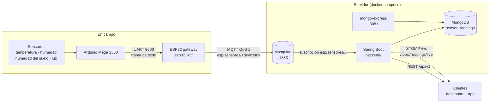
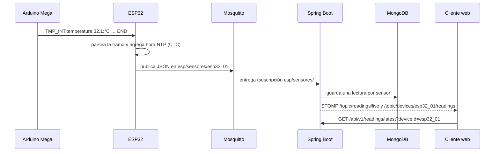

# Sistema de riego IoT

<p>
  
  
  
  
  
</p>

Plataforma de monitoreo para un sistema de riego, desarrollada como proyecto de **vinculación con la
sociedad** (Universidad Técnica de Ambato). Un **Arduino Mega** lee los sensores del cultivo, un
**ESP32** hace de *gateway* y publica las lecturas por **MQTT**, y un backend **Spring Boot** las guarda en
**MongoDB** y las expone por **API REST** y **WebSocket** en tiempo real.

## Arquitectura



## Flujo de una lectura



## Hardware


| Conexión | ESP32 | Arduino Mega | Nota |
|---|---|---|---|
| ESP32 → Mega | GPIO17 (TX2) | RX1 (pin 19) | Directo: 3,3 V se lee como nivel alto en el Mega |
| Mega → ESP32 | GPIO16 (RX2) | TX1 (pin 18) | **Con divisor 1 kΩ / 2 kΩ**: el Mega emite 5 V y el ESP32 trabaja a 3,3 V |
| Tierra | GND | GND | Obligatoria |
| Portal de configuración | GPIO0 (BOOT) | — | Presionado al encender |
| Estado | GPIO2 (LED integrado) | — | Ver patrones abajo |

> **Importante:** los pines del ESP32 no admiten 5 V. Sin el divisor, la señal TX del Mega puede dañar el
> GPIO16 con el tiempo. El divisor (1 kΩ en serie y 2 kΩ a GND) deja la señal en unos 3,3 V.

| LED (GPIO2) | Estado |
|---|---|
| Encendido fijo | Wi-Fi y MQTT conectados |
| Parpadeo lento (1 s) | Wi-Fi conectado, sin MQTT (reintenta cada 5 s) |
| Parpadeo medio (0,5 s) | Sin Wi-Fi, reconectando |
| Parpadeo rápido (0,2 s) | Modo AP: portal de configuración activo |

## Protocolos

**Trama serie (Mega → ESP32)**, una línea por sensor y `END` al final:

```
TMP_INT:temperature:32.1:°C
HUM_INT:humidity:60.2:%
SOIL_1:soil_moisture:41.5:%
END
```

**Mensaje MQTT (ESP32 → broker)**, tópico `esp/sensores/<deviceId>`, QoS 1:

```json
{
  "metadata": { "deviceId": "esp32_01", "timestamp": "2026-11-25T04:16:35Z" },
  "payload": [
    { "sensorId": "TMP_INT", "type": "temperature",   "value": 32.1, "unit": "°C" },
    { "sensorId": "HUM_INT", "type": "humidity",      "value": 60.2, "unit": "%" },
    { "sensorId": "SOIL_1",  "type": "soil_moisture", "value": 41.5, "unit": "%" }
  ]
}
```

## Inicio rápido (servidor)

```bash
docker compose up -d --build
```

| Servicio | Dirección |
|---|---|
| Swagger UI | <http://localhost:8080/swagger-ui.html> |
| API REST | <http://localhost:8080/api/v1/devices> |
| WebSocket (STOMP) | `ws://localhost:8080/ws` |
| MQTT (para el ESP32) | `<IP-del-PC>:1883` |
| mongo-express | <http://localhost:8081> |

La primera vez MongoDB se llena con 1000 lecturas de ejemplo de 10 dispositivos (`mongo-init/01-seed.js`).
Puertos y credenciales se cambian con un `.env` (ver `.env.example`).

### Probar sin hardware

```bash
./tools/simular-esp32.sh            # publica 10 lecturas de esp32_01, una cada 3 s
curl "http://localhost:8080/api/v1/readings/latest?deviceId=esp32_01"
```

El script publica por MQTT exactamente el JSON que arma el firmware, así que prueba el mismo camino que el ESP32.


## API

| Método | Ruta | Descripción |
|---|---|---|
| `GET` | `/api/v1/readings` | Lecturas paginadas |
| `GET` | `/api/v1/readings/latest?deviceId=` | Última lectura de cada sensor de un dispositivo |
| `GET` | `/api/v1/readings/history` | Histórico con filtros (`deviceId`, `type`, `sensorId`, `from`, `to`) |
| `GET` | `/api/v1/readings/stats?deviceId=` | Mínimo, máximo, promedio y cantidad por sensor |
| `GET` | `/api/v1/devices` | Dispositivos registrados |
| `GET` | `/api/v1/devices/{deviceId}/sensors` | Sensores de un dispositivo |

| Tópico STOMP | Contenido |
|---|---|
| `/topic/readings/live` | Todas las lecturas nuevas |
| `/topic/devices/{deviceId}/readings` | Lecturas de un dispositivo |
| `/topic/devices/{deviceId}/sensors/{sensorId}` | Lecturas de un sensor |

Detalle de respuestas y ejemplos: [`backend/API_REST_WEBSOCKET.md`](backend/API_REST_WEBSOCKET.md) ·
peticiones listas para probar: [`backend/api-tests.http`](backend/api-tests.http).

## Firmware del gateway (`esp32_iot/`)

| Módulo | Responsabilidad |
|---|---|
| `esp32_iot.ino` | Arranque, bucle principal, NTP, armado del JSON, LED |
| `SerialParser` | Lee la trama línea por línea hasta `END` |
| `NetManager` | Conexión Wi-Fi con reintentos y modo AP |
| `MqttManager` | Cliente PubSubClient (buffer de 1 KB) y reconexión |
| `WebPortal` | Portal de configuración en `http://192.168.4.1` |
| `ConfigManager` | Configuración persistente en NVS |

**Compilar:** Arduino IDE 2.x, placa **ESP32 Dev Module** (core esp32 3.3.x) y las librerías
**PubSubClient** 2.8 y **ArduinoJson** 7.x desde el gestor de librerías. Compila sin advertencias y usa el
76 % de la flash.

**Configurar:** sin Wi-Fi guardado, o con **BOOT** presionado al encender, el ESP32 crea la red
`ESP32_IoT_<deviceId>`. En `http://192.168.4.1` se configuran el Wi-Fi, el broker MQTT (host, puerto y
tópico base) y el identificador del dispositivo. Si pierde el Wi-Fi y no se reconecta tras 5 intentos,
vuelve al modo AP.

**Probar sin el Mega:** el firmware también lee tramas desde el **Monitor Serie** (115200 baudios). Escriba
las líneas de la trama y `END`, y el ESP32 las publica igual que si vinieran del Mega.

## Limitaciones y pendientes

- El código del **Arduino Mega** (lectura de sensores y envío de tramas) no está en este repositorio.
- Mosquitto acepta conexiones **anónimas** y sin TLS, y las credenciales de MongoDB son de desarrollo: antes
  de exponerlo fuera de la red local hay que activar usuarios en el broker y cambiar las credenciales.
- Las reconexiones Wi-Fi del firmware son bloqueantes durante los reintentos.

## Estructura

```
├── esp32_iot/          Firmware del gateway ESP32 (Arduino)
├── backend/            Spring Boot 4 · Java 21 · MQTT (Paho) · MongoDB · STOMP · springdoc
├── mosquitto/config/   Configuración del broker
├── mongo-init/         Datos de ejemplo
├── tools/              Simulador del ESP32 por MQTT
├── docs/               Esquema de conexiones y capturas
└── docker-compose.yml
```
